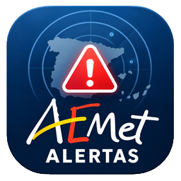
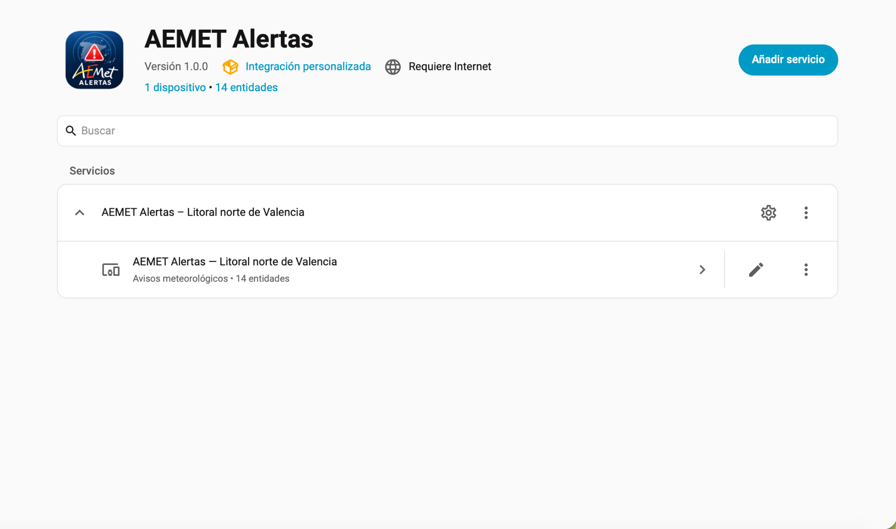
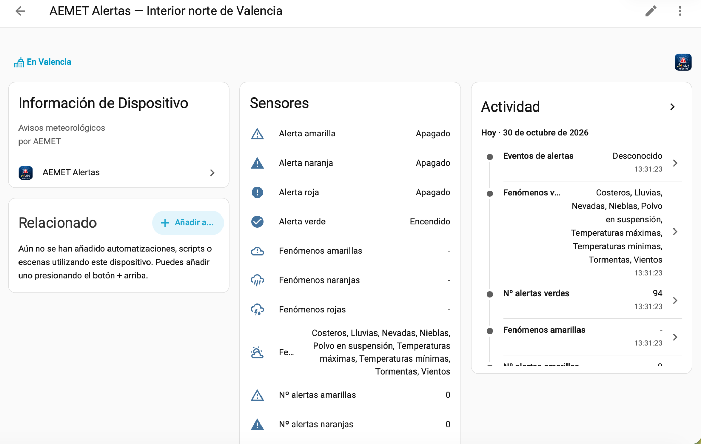
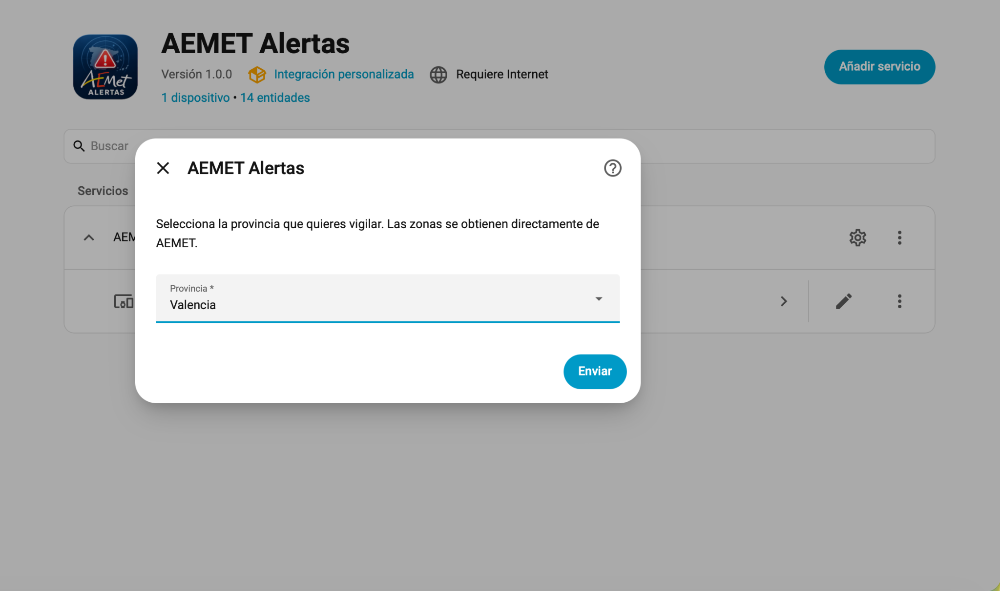
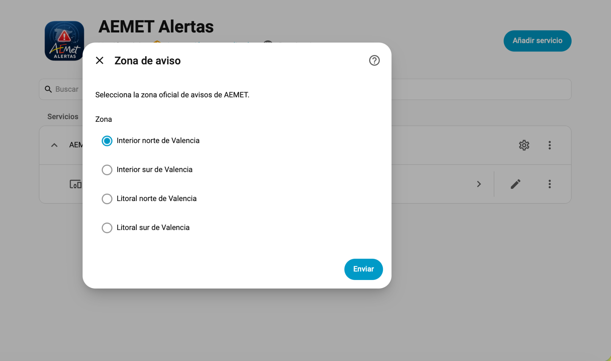
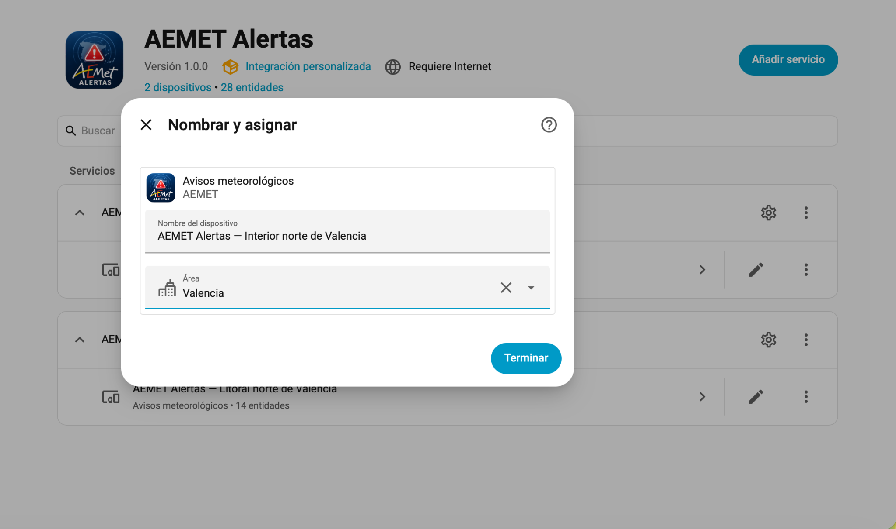
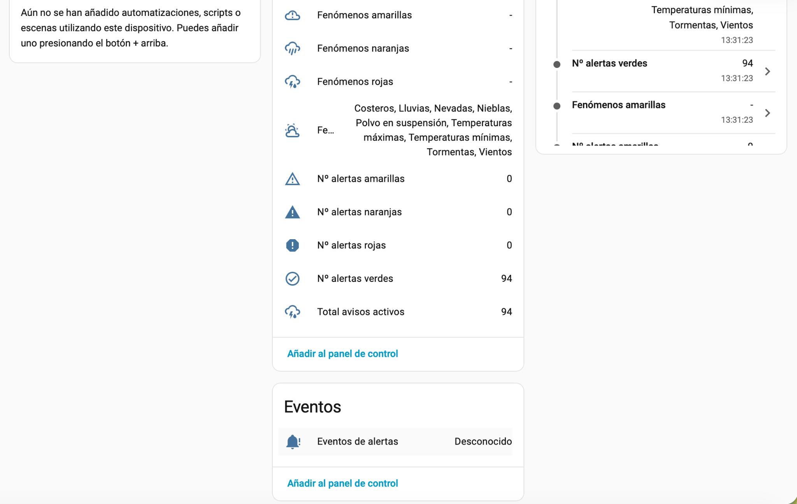

<div align="center">
  

  # AEMET Alertas

  **Avisos meteorológicos de AEMET, directamente en Home Assistant.**

  Integración personalizada para consultar avisos meteorológicos oficiales de AEMET,
  configurarlos desde la interfaz de Home Assistant y utilizarlos en sensores, dashboards y automatizaciones.

  <br>

  [](https://github.com/jacumal/aemet-alertas/actions/workflows/hacs.yaml)
  [](https://github.com/jacumal/aemet-alertas/actions/workflows/hassfest.yaml)
  [](https://github.com/jacumal/aemet-alertas/releases)
  [](LICENSE)
  [](https://www.home-assistant.io/)

</div>

---

## ✨ ¿Qué es AEMET Alertas?

**AEMET Alertas** lleva los avisos meteorológicos publicados por la **Agencia Estatal de Meteorología (AEMET)** directamente a Home Assistant utilizando sus canales oficiales de datos.

La integración descubre las provincias y zonas oficiales disponibles, permite seleccionar qué niveles y fenómenos monitorizar y expone la información mediante dispositivos, sensores, sensores binarios y una entidad `Event` preparada para automatizaciones.

> **Importante:** AEMET Alertas es un proyecto independiente y **no está afiliado, patrocinado, respaldado ni mantenido por AEMET**.

## ☕️ ¿Te resulta útil AEMET Alertas?

Si el proyecto te ayuda a estar al día de los avisos meteorológicos en Home Assistant, puedes **apoyar su desarrollo** con un café. Es totalmente opcional y ayuda a mantener el proyecto, preparar nuevas funciones y mejorar la documentación.

<p align="center">
  <a href="https://www.buymeacoffee.com/jacumal">
    
  </a>
</p>

## 🚀 Características principales

| | Funcionalidad |
|---|---|
| 🌦️ | Datos de avisos directamente desde AEMET |
| 🗺️ | Provincias y zonas oficiales obtenidas dinámicamente de AEMET |
| ⚙️ | Configuración completa mediante Config Flow |
| 🎚️ | Filtros por nivel: verde, amarillo, naranja y rojo |
| 🌧️ | Filtros por fenómeno meteorológico |
| 📊 | Contadores de avisos activos por nivel |
| 🔔 | Sensores binarios para cada nivel de alerta |
| ☁️ | Fenómenos activos agrupados por nivel |
| ⚡ | Entidad `Event` para avisos nuevos, actualizados y finalizados |
| 🏠 | Dispositivo y entidades integrados con Home Assistant |
| 🎨 | Identidad visual propia e independiente de AEMET |

### Niveles soportados

- 🟢 **Verde**
- 🟡 **Amarillo**
- 🟠 **Naranja**
- 🔴 **Rojo**

### Eventos soportados

La entidad de eventos puede generar:

- `new_alert` — nuevo aviso detectado
- `updated_alert` — aviso existente actualizado
- `ended_alert` — aviso finalizado

---

## 🖼️ Así se ve en Home Assistant

La integración utiliza los mecanismos nativos de Home Assistant, incluyendo **Config Flow**, **Device Registry**, **Entity Registry** y una entidad de eventos.

<p align="center">
  
</p>

<p align="center"><em>Integración instalada y disponible desde Dispositivos y servicios.</em></p>

### Dispositivo y entidades

<p align="center">
  
</p>

<p align="center"><em>Cada zona configurada se representa como un dispositivo de Home Assistant.</em></p>

---

## ⚙️ Configuración paso a paso

### 1. Selección de provincia

<p align="center">
  
</p>

La provincia se selecciona desde el asistente de configuración. Las zonas disponibles se obtienen directamente de AEMET.

### 2. Selección de zona oficial

<p align="center">
  
</p>

La integración utiliza las **zonas oficiales de avisos de AEMET**, evitando depender de nombres o divisiones geográficas mantenidas manualmente.

### 3. Dispositivo y asignación a un área

<p align="center">
  
</p>

Cada zona configurada se representa como un dispositivo y puede asignarse a un área de la vivienda, igual que cualquier otra integración de Home Assistant.

---

## 📊 Entidades disponibles

Por cada zona configurada, AEMET Alertas crea un dispositivo con sus entidades asociadas.

### Sensores

- **Total avisos activos**
- **Nº alertas verdes**
- **Nº alertas amarillas**
- **Nº alertas naranjas**
- **Nº alertas rojas**
- **Fenómenos verdes**
- **Fenómenos amarillos**
- **Fenómenos naranjas**
- **Fenómenos rojos**

### Sensores binarios

Un sensor por nivel:

- **Alerta verde**
- **Alerta amarilla**
- **Alerta naranja**
- **Alerta roja**

Esto permite crear automatizaciones sencillas, por ejemplo reaccionar inmediatamente cuando aparece una alerta roja.

### Eventos

<p align="center">
  
</p>

La entidad **Eventos de alertas** permite reaccionar a cambios en los avisos sin tener que consultar continuamente los sensores.

---

## 📦 Instalación

### HACS / Marketplace

AEMET Alertas está preparado para su distribución mediante HACS/Marketplace. Mientras no forme parte del catálogo predeterminado, puede instalarse como repositorio personalizado.

1. Abre **HACS / Marketplace → Integraciones**.
2. Añade `https://github.com/jacumal/aemet-alertas` como repositorio personalizado.
3. Selecciona **Integration**.
4. Instala **AEMET Alertas**.
5. Reinicia Home Assistant.

> 💡 **Consejo:** después de instalar o actualizar una integración personalizada, reinicia Home Assistant para cargar la nueva versión.

### Instalación manual

Copia el directorio:

```text
custom_components/aemet_alertas
```

en:

```text
/config/custom_components/aemet_alertas
```

Después reinicia Home Assistant.

---

## 🧭 Configuración

Después de reiniciar Home Assistant:

**Configuración → Dispositivos y servicios → Añadir integración → AEMET Alertas**

El asistente guía el proceso:

```text
Provincia
   ↓
Zona oficial de AEMET
   ↓
Niveles a monitorizar
   ↓
Fenómenos a monitorizar
```

La configuración puede modificarse posteriormente desde las opciones de la integración.

---

## 🤖 Automatizaciones

AEMET Alertas está pensado para integrarse directamente con las automatizaciones de Home Assistant.

### 🔴 Avisar al móvil cuando aparece una alerta roja

```yaml
alias: AEMET - Aviso de alerta roja
description: Envía una notificación cuando se activa una alerta roja.
triggers:
  - trigger: state
    entity_id: binary_sensor.aemet_alertas_litoral_norte_de_valencia_alerta_roja
    to: "on"
actions:
  - action: notify.mobile_app_iphone
    data:
      title: "🚨 Alerta roja AEMET"
      message: "Se ha activado una alerta roja en la zona configurada."
mode: single
```

### 🟠 Encender una luz cuando aparece una alerta naranja

```yaml
alias: AEMET - Alerta naranja
description: Enciende una luz cuando existe una alerta naranja.
triggers:
  - trigger: state
    entity_id: binary_sensor.aemet_alertas_litoral_norte_de_valencia_alerta_naranja
    to: "on"
actions:
  - action: light.turn_on
    target:
      entity_id: light.luz_entrada
mode: single
```

> Los nombres exactos de las entidades dependen de la zona configurada en Home Assistant.

---

## ⚡ Eventos para automatizaciones avanzadas

La entidad `Event` permite reaccionar cuando AEMET detecta cambios en los avisos.

```text
new_alert
updated_alert
ended_alert
```

Esto permite construir notificaciones inteligentes, registrar el histórico de avisos o activar escenas dependiendo del tipo de cambio detectado.

---

## 🛰️ Fuente de datos

Los datos se obtienen directamente de los canales oficiales de AEMET para las zonas de aviso y de los mensajes **CAP 1.2** publicados por AEMET.

La integración procesa, entre otros elementos:

- Catálogo oficial de zonas.
- Fichero de estado de avisos.
- Mensajes CAP 1.2.
- Nivel oficial `AEMET-Meteoalerta nivel`.
- Información oficial del fenómeno y parámetros CAP.

La integración **no depende de MeteoAlarm ni de Feedreader**.

Para las condiciones de reutilización de los datos, consulta el [aviso legal de AEMET](https://www.aemet.es/es/nota_legal).

---

## ☕️ Apoya el proyecto

Si **AEMET Alertas** te resulta útil y quieres apoyar su mantenimiento y desarrollo, puedes invitarme a un café a través de **Buy Me a Coffee**:

<p align="center">
  <a href="https://www.buymeacoffee.com/jacumal">
    
  </a>
</p>

El apoyo es totalmente opcional y ayuda a dedicar tiempo a nuevas funciones, mantenimiento, documentación y soporte de la integración.

---

## 🛠️ Desarrollo y calidad

El repositorio incorpora validación automática mediante **HACS** y **Home Assistant Hassfest** en cada cambio.

Ambas validaciones están pasando actualmente en el commit principal. Antes de publicar una versión se comprueba que la integración mantiene una estructura compatible con los validadores de Home Assistant y HACS.

---

## 📌 Estado del proyecto

**Versión actual: 1.0.1**

Primera versión pública estable de la integración personalizada.

El proyecto está en evolución y se aceptan sugerencias, mejoras y reportes de errores mediante GitHub Issues.

---

## ⚖️ Aviso legal y marca

AEMET Alertas utiliza información meteorológica publicada por la **Agencia Estatal de Meteorología (AEMET)**.

**Este proyecto no es oficial de AEMET y no está afiliado, patrocinado, respaldado ni mantenido por AEMET.**

El nombre AEMET se utiliza únicamente para identificar la fuente de los datos meteorológicos utilizados por esta integración. La identidad visual del proyecto es independiente y no pretende reproducir la imagen corporativa oficial de AEMET.

Consulta las condiciones de reutilización de AEMET antes de redistribuir o utilizar los datos obtenidos mediante esta integración:

https://www.aemet.es/es/nota_legal

---

## 📄 Licencia

Este proyecto se distribuye bajo licencia **MIT**. Consulta [`LICENSE`](LICENSE) para más información.

## 👨‍💻 Créditos

Desarrollado por **Javi / [@jacumal](https://github.com/jacumal)** para la comunidad de Home Assistant.

AEMET y sus contenidos meteorológicos son propiedad de la **Agencia Estatal de Meteorología**. Este proyecto utiliza dichos datos como fuente y no reclama ninguna titularidad sobre ellos.

---

<div align="center">

**AEMET Alertas · Home Assistant · Avisos meteorológicos**

</div>
